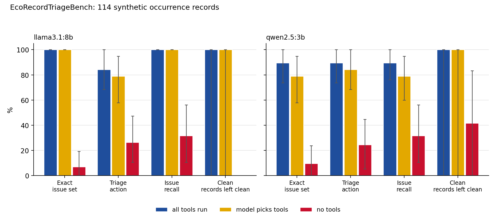

# EcoRecordTriageBench

[](https://doi.org/10.5281/zenodo.24227218)

**Tool-using agent triage of citizen-science biodiversity occurrence records**

## Why this project

Biodiversity occurrence records are useful only when their metadata can be interpreted responsibly. GBIF documents more than 60 occurrence issues and flags, including invalid/zero coordinates, invalid dates and date-component mismatches. iNaturalist uses a separate community Data Quality Assessment: a verifiable observation needs a date, georeferencing, media evidence and a wild/not-captive status; Research Grade additionally depends on community identification agreement and agreement between observation and community taxa. These are related but not identical quality systems.

Recent peer-reviewed LLM work in ecology has benchmarked species-level tasks such as taxonomy, geographic distribution, conservation status and threat identification. That work reports substantial task-dependent performance differences. EcoRecordTriageBench deliberately studies a narrower, different question: **can a tool-using agent correctly orchestrate deterministic metadata checks and route a record to a sensible curator action without treating every record type as if it were a casual field observation?**

This is a controlled methods benchmark, not a claim that an LLM should replace biodiversity curators, taxonomists or GBIF/iNaturalist quality systems. It is distinct from generic historical reasoning and species-knowledge benchmarks because its unit of evaluation is an occurrence-record metadata bundle plus tool-selection and triage behaviour.

## Research gap and novelty boundary

The existing infrastructure already supplies mature deterministic flags and community review workflows. Therefore, this project does **not** claim to invent occurrence validation, species identification, or a new biodiversity quality standard. The narrower research question is the evaluation of an LLM agent that selects and composes existing read-only validators, then maps their outputs to a bounded curator workflow. The initial dataset is synthetic and controlled; a defensible publication claim would require later expert annotation and evaluation on real, appropriately licensed occurrence records. The gap is provisional and must be revisited through a fuller systematic review before journal submission.

## Research questions

- **RQ1:** How accurately can a tool-using LLM agent identify controlled metadata-quality issues compared with a deterministic all-checks baseline?
- **RQ2:** How does selective validator invocation affect issue recall, tool precision/recall and false-positive burden?
- **RQ3:** Do record-type-aware exceptions (for example, preserved specimens not requiring the same media/identification checks as human observations) reduce inappropriate triage?

## Falsifiable hypotheses

- **H1:** The deterministic reference agent will achieve perfect agreement with the controlled labels because the labels are generated from explicit mutation recipes; this is a pipeline sanity check, not a model-performance result.
- **H2:** On this small synthetic set, a local LLM agent will have lower issue-set exact match than the deterministic baseline unless its tool plan covers all relevant validator families.
- **H3:** Including preserved-specimen controls will expose false positives from agents that apply human-observation rules indiscriminately.

The *Results* section reports what the local run found for each hypothesis.

## Scope and dataset

- 114 **synthetic** cases: 19 scenario families × 6 deterministic variants.
- Scenario families cover valid human observations, coordinate/date errors, missing media, captive/cultivated status, limited identification agreement, taxon conflicts, multi-issue cases, and preserved-specimen controls.
- Each case includes a `record` using Darwin Core occurrence fields plus explicitly documented platform-inspired extension fields, a controlled expected issue set, a triage action, and an explicit `synthetic: true` marker.
- No real citizen-science observations, personal observer identifiers, images, or sensitive locations are included.
- The fixed reference date (`2026-01-01`) makes future-date checks reproducible and independent of the day the benchmark is run.

**Important:** the dataset is a test fixture, not a sample of real biodiversity records. The synthetic labels measure implementation behaviour under known perturbations; they do not estimate real-world prevalence or ecological validity.

## Methodology

The agent receives one record and a menu of five read-only local tools:

1. `check_basis_of_record`
2. `check_coordinates`
3. `check_dates`
4. `check_verifiability`
5. `check_identification`

Local models run through Ollama with JSON-schema output in three conditions:

| Condition | What the model does | What it isolates |
|---|---|---|
| `all_tools` | every validator applicable to the record type runs; the model reads their outputs and returns issue codes and an action | reading tool output and applying the triage policy |
| `selective` | the model first chooses which validators to run, the chosen ones run locally, then it returns issue codes and an action | the cost of letting the model plan its own checks |
| `no_tools` | the model reads the record and the issue definitions and returns issue codes and an action with no tool | what the validators add |

With tools, the reported issue list is restricted to issues the tools actually returned; the model's own list before that filter is kept, so unsupported claims can be counted. The model cannot change records or reach the network. The deterministic `rules` baseline runs every validator applicable to the record type: human observations use all five, while specimens and other record types skip the iNaturalist-style media and identification checks.

### Baselines

- **All-checks rule agent:** runs the applicable validators and applies the triage policy. Its perfect score is a check of the software, not a model result.
- **Model conditions:** `qwen2.5:3b` and `llama3.1:8b`, temperature 0, at most 256 output tokens per call.

### Metrics

- issue micro precision, recall and F1;
- issue macro F1;
- exact issue-set accuracy;
- triage-action accuracy;
- clean-case specificity and false-positive clean-case rate;
- tool precision and tool recall against the validator families applicable to each record type;
- invalid-output rate, unsupported-issue claims, and how often a non-observation record (a preserved specimen) is given a media, captive or identification issue by the model's own list.

`scripts/analysis.py` reports 95% cluster-bootstrap intervals that resample the 19 scenario families (the six variants of a family are near copies), paired differences between conditions of the same model, and accuracy for every family. With 114 synthetic cases these are descriptive and should not be generalised to field records.

## Reproduction

Python 3.9+; standard library only. No model download is required for the deterministic baseline.

```bash
python3 -m unittest discover -s tests -v
python3 scripts/generate_dataset.py
python3 -m ecorecord_triage.cli --agent rules --output-dir outputs/rules
```

Full model study (needs [Ollama](https://ollama.com) with `qwen2.5:3b` and `llama3.1:8b`; 912 model calls):

```bash
python3 -m venv .venv && source .venv/bin/activate
pip install matplotlib            # charts only
./scripts/run_all.sh
```

Each record is saved to `outputs/llm/<model>_<condition>/calls.jsonl` as it finishes; if the run stops, run the same command again and it continues. Results go to `results/tables.md`, `results/results.json` and `results/fig_conditions.png`. One condition on its own:

```bash
python3 -m ecorecord_triage.cli --agent ollama --model qwen2.5:3b --mode selective
```

Ollama version, model digest, Python version and platform are recorded in each `summary.json`.

## Results

Local run on 14 November 2026: MacBook (Apple silicon), Ollama 0.40.16, temperature 0, seed 20261114, 114 records per condition, 912 model calls, no invalid outputs. Values are percentages with 95% cluster-bootstrap intervals over the 19 scenario families. Full tables, paired differences and per-family scores are in [`results/tables.md`](results/tables.md); raw replies are in `outputs/llm/`.

| Metric | llama3.1:8b all tools | llama3.1:8b picks tools | llama3.1:8b no tools | qwen2.5:3b all tools | qwen2.5:3b picks tools | qwen2.5:3b no tools |
|---|---|---|---|---|---|---|
| Exact issue set | 100.0 [100.0, 100.0] | 100.0 [100.0, 100.0] | 7.0 [0.0, 19.3] | 89.5 [73.7, 100.0] | 78.9 [57.9, 94.7] | 9.6 [0.0, 23.7] |
| Triage action | 84.2 [68.4, 100.0] | 78.9 [57.9, 94.7] | 26.3 [10.5, 47.4] | 89.5 [73.7, 100.0] | 84.2 [68.4, 100.0] | 24.6 [5.3, 44.7] |
| Issue recall | 100.0 | 100.0 | 31.6 | 89.5 | 78.9 | 31.6 |
| Issue precision | 100.0 | 100.0 | 20.6 | 100.0 | 100.0 | 12.9 |
| Tool recall (model picks) | | 96.1 [92.3, 99.3] | | | 86.5 [82.8, 91.0] | |
| Observation rule on specimens | 33.3 | 33.3 | 0.0 | 0.0 | 22.2 | 100.0 |



**What the validators add (RQ1, H2).** Without tools both models almost never return the exact issue set (7.0% and 9.6%) and pick the right action for about a quarter of records. Against the all-tools condition this is a drop of 93.0 [80.7, 100.0] points for llama3.1:8b and 79.8 [63.2, 95.6] points for qwen2.5:3b. Without tools llama3.1:8b flagged every clean record (0% left clean). On this set the validators, not the models, do most of the detection.

**Letting the model choose its checks (RQ2).** llama3.1:8b kept a perfect issue set when it chose its own tools (tool recall 96.1%). qwen2.5:3b skipped more checks (tool recall 86.5%) and its exact issue set fell by 10.5 points [−26.3, 0.0]; it failed every record in the missing-coordinate and non-numeric-coordinate families. The intervals touch zero, so this is a direction, not a settled difference.

**Reading the tools is not the same as applying the policy.** With every tool run, llama3.1:8b returned the correct issue set for all 114 records but the correct action for only 84.2%. The misses were three whole families: the specimen control, the specimen with an invalid coordinate, and a record with both a date mismatch and low identification consensus. qwen2.5:3b, the smaller model, had the higher action accuracy with all tools (89.5%), and its misses came from issues it did not report (zero coordinate, low consensus, coordinate plus media).

**Specimen controls (RQ3, H3).** For the 18 records that are not human observations (12 preserved specimens and 6 with an unrecognised record type), llama3.1:8b's own issue list (before the tool filter) contained an observation-only issue such as missing media for a third of them in both tool conditions; without tools, qwen2.5:3b did so for all 18. The tool filter removed these from the reported issues, but no configuration reached the correct action on the specimen control family. The data support H3 at the level of the model's own list. With only three such families the intervals span 0 to 100, so the rate itself is not precise.

**Rule baseline (H1).** The all-checks rule agent scored 100% on every metric, confirming the pipeline; this is a software check, not a model result.

These are results on a small synthetic fixture with two models, one seed and one machine. They describe behaviour under controlled perturbations and should not be read as performance on real occurrence records.

## Experiment protocol for a publishable extension

1. Freeze the current synthetic v0.1.0 dataset and run the test suite.
2. Conduct a systematic literature search across biodiversity informatics, citizen science, data quality, LLM agents and tool-using evaluation.
3. Ask biodiversity data curators to review the rule definitions and triage mapping before creating a real-record track.
4. Build a separate, consented/licensed real-record test set. Preserve source licence, source ID, retrieval date and any coordinate generalisation; do not redistribute restricted coordinates or media.
5. Separate development and held-out records by source dataset and taxon to reduce leakage.
6. Compare the all-checks baseline, no-tool LLM, tool-using LLM and oracle-tool ablation across at least 5 seeds where model sampling permits.
7. Report per-issue precision/recall, macro F1, triage accuracy, tool coverage, false-positive burden, latency and token/call cost.
8. Have at least two qualified reviewers independently annotate real-record cases; report agreement and adjudication. Do not treat iNaturalist Research Grade as infallible ground truth.
9. Publish prompts, model versions, exact data licences, annotation guidelines, raw per-case outputs and analysis scripts.

## Limitations

- Synthetic cases cannot establish performance on noisy real submissions, ecological plausibility, geographic range or species identity.
- The benchmark omits country-polygon checks, taxonomic synonym resolution, image/audio verification, phenology and sampling bias.
- The identification consensus check is intentionally simplified. iNaturalist's production community-taxon algorithm is more nuanced than a raw agreement-count ratio.
- A correct metadata triage action does not establish that a species identification is correct or that a record is fit for every downstream analysis.
- The deterministic baseline is expected to dominate on rules it directly implements; this is a diagnostic reference, not an argument for LLM autonomy.
- Legal, ecological and platform-specific decisions remain with qualified humans and the authoritative data providers.

## Ethics and responsible use

- Do not use this package to automatically delete, reject or downgrade observations.
- Do not infer observer competence or intent from metadata anomalies.
- A flagged record means “inspect or correct this field,” not “the observation is false.”
- Avoid exposing precise locations of threatened species or sensitive taxa in any future real-data track.
- Respect iNaturalist observation-level licences and GBIF dataset licences; do not assume all records are freely redistributable.
- The current dataset is synthetic and contains no personal data.

## Issue codes

Where GBIF has an equivalent flag the same name is used (`BASIS_OF_RECORD_INVALID`, `COORDINATE_OUT_OF_RANGE`, `ZERO_COORDINATE`, `RECORDED_DATE_INVALID`, `RECORDED_DATE_MISMATCH`). The others are benchmark codes: GBIF's nearest flags are `COORDINATE_INVALID` (here `COORDINATES_INVALID`) and `RECORDED_DATE_UNLIKELY`, which covers future and very old dates (here `RECORDED_DATE_FUTURE` covers future dates only). Missing coordinates or dates, media, captive status and identification issues come from iNaturalist's Data Quality Assessment, not from GBIF flags.

## Data dictionary and project files

See [`docs/LITERATURE_REVIEW.md`](docs/LITERATURE_REVIEW.md), [`docs/DATA_DICTIONARY.md`](docs/DATA_DICTIONARY.md), [`docs/EXPERIMENT_PROTOCOL.md`](docs/EXPERIMENT_PROTOCOL.md) and [`data/DATA_CARD.md`](data/DATA_CARD.md).

## References and provenance

1. Darwin Core / TDWG, current biodiversity data-sharing standard: https://dwc.tdwg.org/
2. GBIF, Occurrence issues and flags: https://techdocs.gbif.org/en/data-use/occurrence-issues-and-flags
3. iNaturalist, Data Quality Assessment and Research Grade criteria: https://help.inaturalist.org/en/support/solutions/articles/151000169936
4. iNaturalist, Community Taxon and Observation Taxon definitions and algorithm: https://help.inaturalist.org/en/support/solutions/articles/151000173076
5. Campbell, C. J., Barve, V., Belitz, M. W., Doby, J. R., White, E., Seltzer, C., Di Cecco, G., Hurlbert, A. H. and Guralnick, R. (2023), “Identifying the identifiers: How iNaturalist facilitates collaborative, research-relevant data generation and why it matters for biodiversity science,” *BioScience*, 73(7), 533–541: https://doi.org/10.1093/biosci/biad051
6. Dorm, F., Millard, J., Purves, D., Harfoot, M. and Mac Aodha, O. (2026), “Large language models possess some ecological knowledge, but how much?”, *Ecological Informatics*, 95, 103699: https://doi.org/10.1016/j.ecoinf.2026.103699
7. GBIF, data-quality handling guide: https://training.gbif.org/en/data-use/data-quality

## How to cite

```bibtex
@misc{hussain2026ecorecord,
  author    = {Hussain, Muzammal},
  title     = {{Seeing the Problem Is Not Following the Policy: Small Local LLM Agents in Two Rule-Bound Triage Tasks}},
  year      = {2026},
  publisher = {Zenodo},
  doi       = {10.5281/zenodo.24509189},
  url       = {https://doi.org/10.5281/zenodo.24509189}
}
```

Software (code, notebooks, results): [doi:10.5281/zenodo.24227218](https://doi.org/10.5281/zenodo.24227218).

## Licence and citation

Code: MIT. Synthetic dataset: CC0-1.0. See `LICENSE`, `data/DATA_CARD.md` and `CITATION.cff`.
